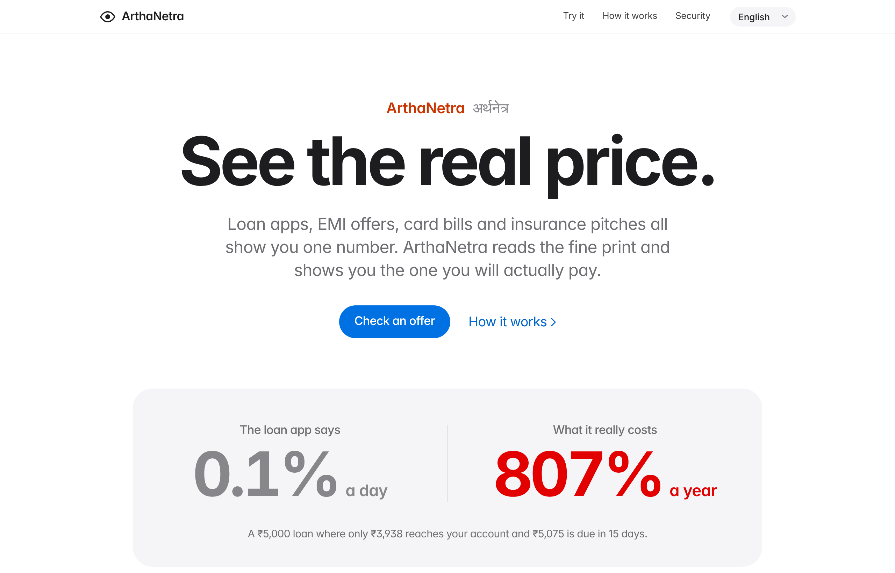
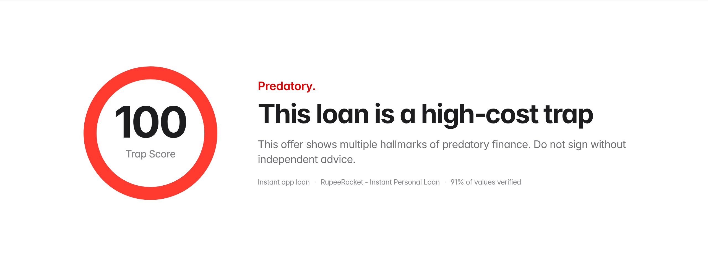
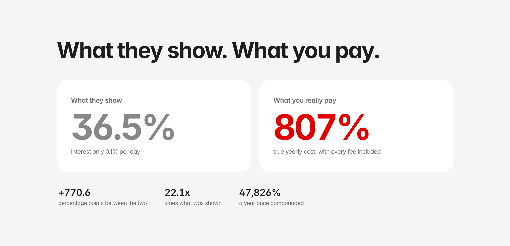
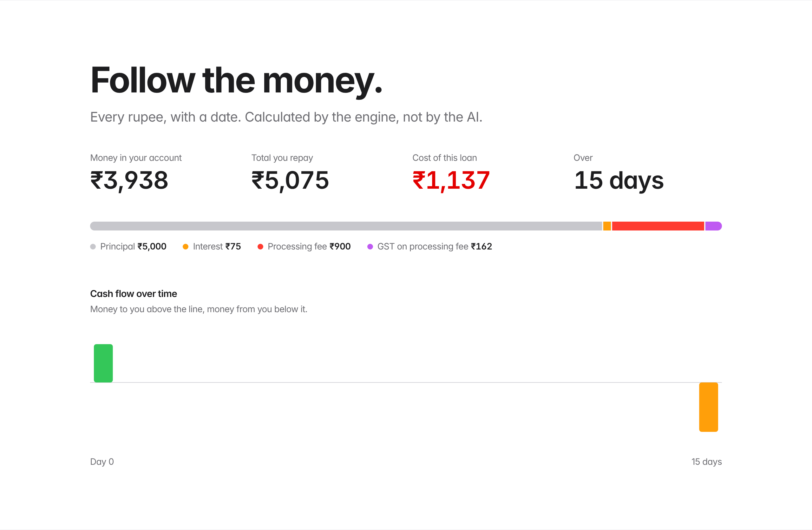
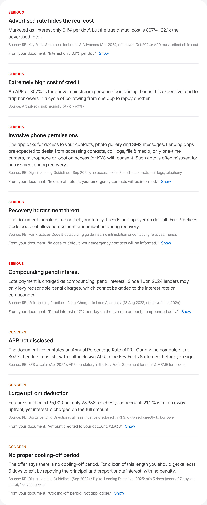
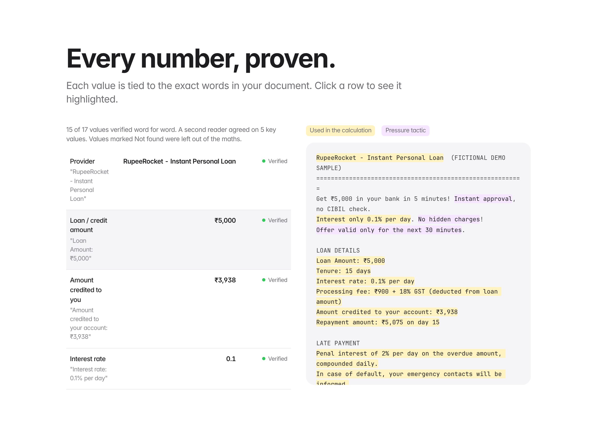
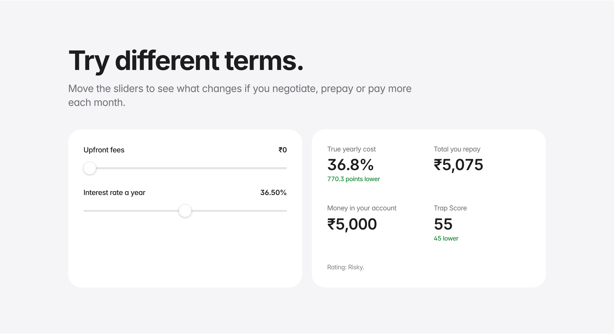
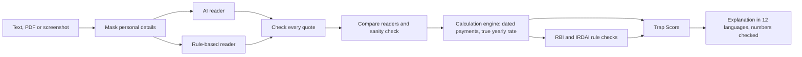

# ArthaNetra

**See the real price.**

ArthaNetra reads a loan offer, an EMI deal, a Key Facts Statement, a credit card bill or an insurance agent's
WhatsApp pitch, and tells you what it will actually cost you. It checks every number against the document, works out
the true yearly cost with a calculation engine, flags anything that goes against RBI or IRDAI rules, and explains the
result in 12 Indian languages.

Built for Arthaton 2026 (theme: AI for Finance).

**🌐 Live demo:** [https://arthanetra.onrender.com](https://arthanetra.onrender.com) *(free Render instance: the first visit after a quiet spell can take up to a minute to wake up)*



## Why we built this

Most people never see the real price of the credit they take. The number on the screen is real, it is just not the
number that matters.

| What the offer says | What ArthaNetra finds in the same document |
|---|---|
| Loan app: "Interest only 0.1% per day. No hidden charges." | 807% a year. ₹5,000 sanctioned, ₹3,938 credited, ₹5,075 due in 15 days |
| Phone checkout: "No-Cost EMI, 0% interest" | 36.7% a year once the lost cash discount, the fee and GST on interest are counted |
| Two-wheeler loan: "Lowest rate, just 9%" | 18.7% a year. The 9% is a flat rate, about 16.4% on a reducing balance |
| Credit card bill: "Pay just the minimum" | More than 30 years to clear ₹50,000, and ₹3.1 lakh paid in total |
| Agent on WhatsApp: "₹16.5 lakh guaranteed, double your money" | 3.26% a year. The same premiums at 7.1% would grow to ₹29.5 lakh |

In 2021 an RBI working group on digital lending found that about 600 of roughly 1,100 lending apps it looked at were
operating illegally. RBI now requires lenders to show an all-inclusive APR, give a cooling-off period, stay away from
your contacts and photos, and not compound penalty interest. A first-time borrower still has no easy way to check any
of this before tapping Accept. That is the gap ArthaNetra fills.

## What you get

- **Trap Score** from 0 to 100, with a breakdown of exactly how it was calculated
- **What they show vs what you pay**, side by side, plus the gap between them
- **Follow the money**: every payment with its date, the real yearly cost, and where each rupee goes
- **Rule checks**: 21 checks based on RBI and IRDAI circulars, each with its source and the sentence that triggered it
- **Proof**: every value shown next to the exact words it came from, highlighted in your document
- **Try different terms**: change the fee, the rate, the payment or the prepayment month and watch the result update
- **Plain-language explanation** in 12 Indian languages, questions to ask before signing, and a message you can send
  back to the lender or agent
- **The whole app in 12 languages.** Switch the language at any time and every heading, result and rule explanation
  changes instantly, even with no internet AI service
- **Ask a question** by typing or speaking, in any language. Common questions (cost, fees, late payment, cancelling,
  guarantees, safety) are answered offline from the calculation

| | |
|---|---|
|  |  |
|  |  |
|  |  |

## How it works

The idea is simple: **the AI reads, the maths is done by code.** Language models are good at reading messy documents
and bad at arithmetic, and a made-up number in a money decision is not acceptable. So we split the work.

1. **Reading with proof.** An AI model extracts each term and must quote the exact words from the document for every
   value. We check each quote against the document and check that the number really appears in it. Anything that
   cannot be proven is kept out of the calculation.
2. **A second reader.** A rule-based reader goes through the same document independently. Where the two agree,
   confidence goes up. Where the AI missed something the second reader proved, it is recovered.
3. **A sanity check.** If the AI's reading leads to an impossible result, the verified rule-based reading is used.
4. **One engine for every product.** Loans, EMI offers, credit cards and insurance plans are all turned into a list of
   dated payments, and the true yearly rate is solved from that list. The solver stays stable from -99% to well over
   a million percent, which matters for instant loan apps.
5. **Rule checks as code.** Each RBI or IRDAI rule is a small, versioned function with a citation.
6. **Checked explanations.** Every number the AI writes in an explanation or answer is matched against the
   calculation. Numbers that do not match are flagged to the user.

The full list of what is new in this approach is in [docs/IPR.md](docs/IPR.md). Architecture details are in
[docs/ARCHITECTURE.md](docs/ARCHITECTURE.md).



## Security and privacy

Financial documents carry personal details, so security is part of the design, not an add-on. Full details are in
[SECURITY.md](SECURITY.md).

- Phone, PAN, Aadhaar, account, card, IFSC, UPI and email details are masked before any text is sent to an AI service
- Nothing is stored. No database, no accounts, documents are processed in memory and discarded
- File type is checked from the file's own bytes; renamed executables, password-protected PDFs and oversized files are rejected
- Rate limits per client, strict security headers (Content Security Policy, no framing, no sniffing), no wildcard CORS
- Text inside a document is treated as data, so hidden instructions cannot change the maths or the verdict
- Each report carries an ID derived from the document and the result, so a shared report can be checked
- API keys live only on the server and are never sent to the browser

## Run it

You need Python 3.10 or newer. No API key is needed; ArthaNetra works fully offline, in all 12 languages. A free key
adds AI reading of any wording, free-form questions and voice questions.

```bash
git clone https://github.com/<your-username>/arthanetra.git
cd arthanetra
cp .env.example .env     # optional: add a free GROQ_API_KEY from console.groq.com
./run.sh                 # on Windows: run.bat
```

Then open http://localhost:8000 and pick an example.

<details>
<summary>Manual setup, Docker and tests</summary>

```bash
cd backend
python -m venv .venv && source .venv/bin/activate     # Windows: .venv\Scripts\activate
pip install -r requirements.txt
uvicorn app.main:app --port 8000
```

```bash
docker build -t arthanetra .
docker run -p 8000:8000 -e GROQ_API_KEY=your_key arthanetra
```

```bash
cd backend && python -m pytest -q
```

To deploy for free, push the repo to GitHub, open Render.com, choose New Blueprint, pick the repo (it uses
`render.yaml`) and add `GROQ_API_KEY`.
</details>

| Key | What it adds |
|---|---|
| none | The full engine, rule checks, Trap Score, simulator, proof view, the whole app and its explanations in 12 languages, answers to common questions |
| `GROQ_API_KEY` | AI reading of any wording, AI-written explanations, free-form questions, voice questions |
| `GEMINI_API_KEY` | AI reading plus screenshots and scanned PDFs |

## API

| Endpoint | What it does |
|---|---|
| `POST /api/analyze` | Form fields `text` or `file`, `language`, `benchmark`, `offline`. Returns the full analysis |
| `POST /api/simulate` | JSON `{model, facts, document_text}`. Recalculates cost, rule checks and score |
| `POST /api/ask` | JSON `{question, analysis, document_text, language}`. Returns a checked answer |
| `POST /api/transcribe` | Audio file in, text out |
| `GET /api/rules` | The rule set with citations |
| `GET /api/samples` | The example documents |

Interactive API docs are at `/docs`.

## Project layout

```
backend/app/
  engine/cashflow.py   calculation engine (true yearly rate, EMI, cards, insurance)
  engine/rules.py      RBI and IRDAI rule checks with citations
  engine/patterns.py   pressure-tactic detection
  engine/score.py      Trap Score and disclosure gap
  extractor.py         reading with proof, quote checks
  heuristic.py         rule-based second reader (also the offline reader)
  pipeline.py          puts it all together, compares readers, sanity check
  explain.py           explanations, offline answers, number checks
  i18n/                all text in 12 languages (en.json is the source)
  security.py          personal detail masking, rate limits, headers, file checks, report IDs
  llm.py               Groq, Gemini or offline
  main.py              FastAPI app
backend/samples/       7 fictional example documents and 2 PDFs
backend/tests/         tests: maths, pipeline, API, security, languages
frontend/              the web app (plain HTML, CSS and JavaScript)
docs/                  pitch deck, IP notes, architecture, demo script, checklist
```

## Who it is for

First-time borrowers, students, gig workers, families in smaller towns, and older people being sold "guaranteed"
plans. The same API can power a WhatsApp number where people forward any offer, a browser extension on checkout
pages, and a service for lenders who want to show their pricing is honest. The business model is in the
[pitch deck](docs/ArthaNetra_Pitch_Deck.pdf).

## Limits

ArthaNetra helps people understand offers. It is not legal, tax or investment advice. Rule references reflect our
reading of public RBI and IRDAI circulars as of rule set `IN-2026.11`. All example documents and company names are
fictional.

## Credits

FastAPI, Uvicorn, httpx, pypdf, the Groq API (gpt-oss and Whisper models), the Google Gemini API, and the Inter
typeface. Each is used under its own licence or terms.

## Licence

Copyright 2026 the ArthaNetra team. All rights reserved; the source is shared for Arthaton 2026 judging. See
[LICENSE](LICENSE) and [docs/IPR.md](docs/IPR.md).
